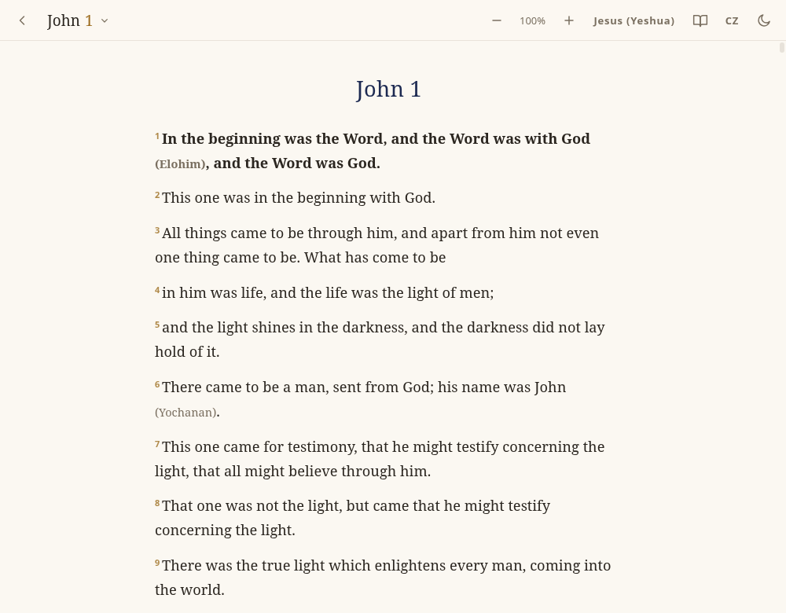

# Bible Source Version (BSV) — reader app

The reader for the **Bible Source Version (BSV)**, a translation from the
Hebrew, Aramaic and Greek in English and Czech. Names and terms read in their
original form, familiar form, or both. Desktop (Electron) and Android, built on
[aio](https://github.com/riagentic/aio).



The text lives in the [word](https://github.com/riagentic/word) repo
(`bsv-en`, `bsv-cz`) and is linked here as `bible/word`.

## Run and build

```sh
am fix                       # once after a clone: framework link, node_modules
deno task text               # bible/word → text/ (+ the app version); run before a build
am start                     # run the desktop app (am stop to end it)
deno task check && deno task lint && deno task test
am build android electron --platforms=linux,windows,macos,macos-arm64  # → dist/bsv-<version>.apk, .AppImage, Windows .zip, macOS .dmg
```

The version is `"version"` in deno.json (major.minor) plus the git commit count.

## Map

- `src/` — the app: `cell.ts` (state), `App.tsx`, `ui/` (screens, About), `lib/` (book rendering, names, dictionary)
- `content/` — `terms.json` (names and terms lexicon), dictionary glossaries
- `scripts/` — `text.ts` (builds `text/`), `export.ts`, `icon.ts`
- `tools/fix/` — the source-pass rules (`BRIEF.md`, `OT.md`, cautions per book group), word lists (`WORDS.md` Greek, `WORDS-HE.md` Hebrew), review log (`log/source.md`)
- `tools/terms/` — name/term token rules and the checker (`check.ts`)
- `tools/cz/` — Czech style guide and checker
- `tools/src/` — `orig.ts` (original text per chapter), `words.ts` (word-list rows per chapter)

## License

App: MIT ([LICENSE](LICENSE)). Text: CC BY-SA 4.0 (see the word repo).
